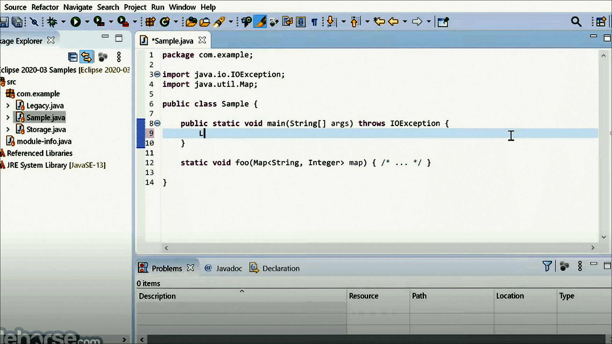
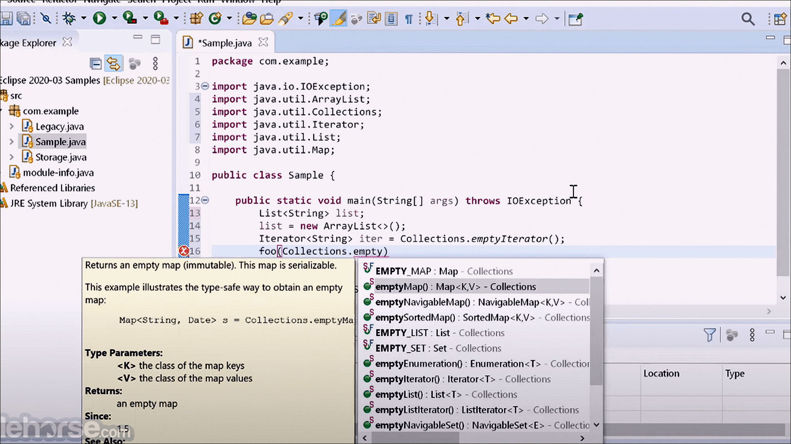
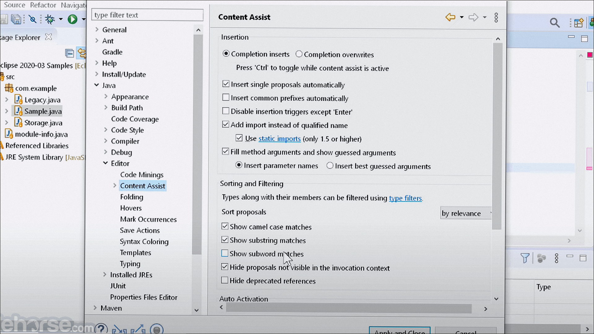

# Windows notes: PyCharm

**JetBrains** · 2026.2 · 903 MB · Utilities catalog

[Open card](https://moggydayprogram.com/programs/pycharm) · [English](https://moggydayprogram.com/en/programs/pycharm) · [GitHub Pages](https://meshherbalistknow.github.io/pycharm-windows/?lang=en)

  
  
  

IDE для Python. Это Professional-триал, не бесплатная Community.

PyCharm on Windows 10/11 x64. 903 MB. Requirements, screenshots, MoggyDay Launcher.

Get it from the catalog card, not from this repository.

| Field | Value |
| --- | --- |
| Build | 2026.2 Professional (триал) |
| OS | Windows 10/11 x64 |
| Pages | https://meshherbalistknow.github.io/pycharm-windows/ |

- [Total Commander](https://moggydayprogram.com/programs/total-commander)
- [Notepad++](https://moggydayprogram.com/programs/notepad-plus-plus)
- [VMware Workstation](https://moggydayprogram.com/programs/vmware-workstation)
